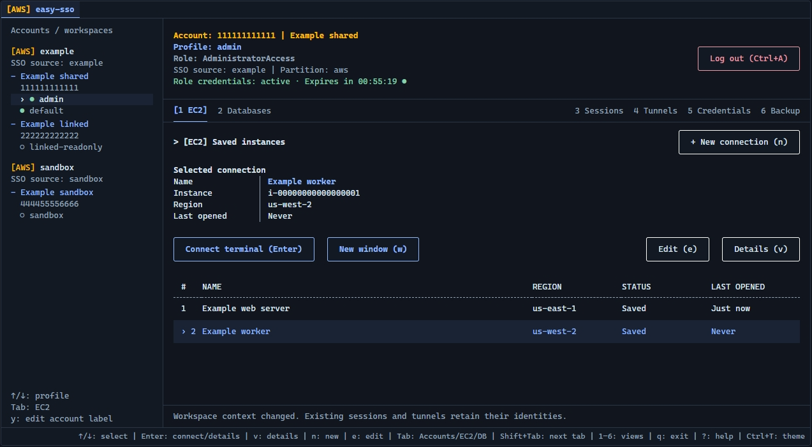
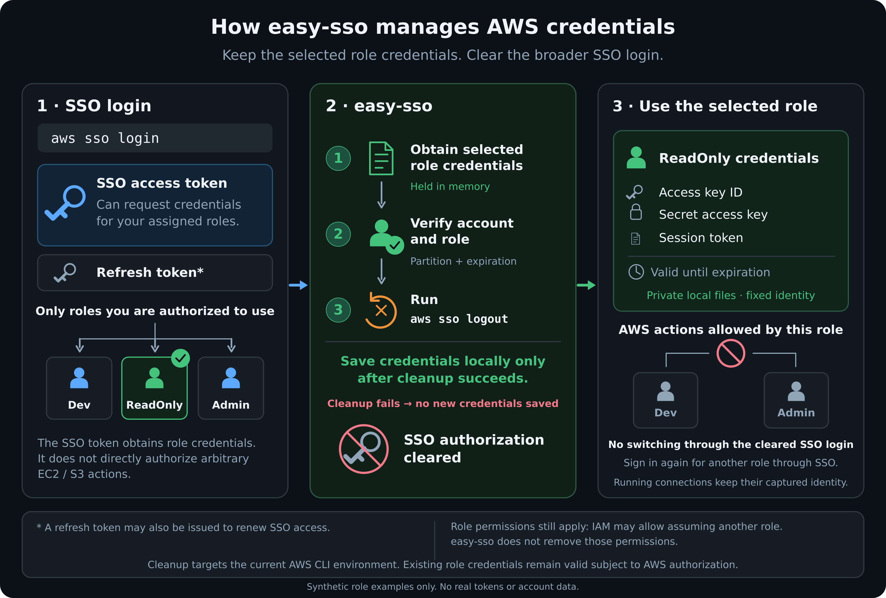

# easy-sso

**Your AWS accounts, roles, and connections. One terminal workspace.**

Sign in to AWS, choose a role, and open an EC2 shell, a PostgreSQL session or a DocumentDB tunnel from a keyboard-and-mouse terminal app. Save connections, see which identity each session uses, and manage shells and database tunnels in one place.

[](https://thamaldilanka.github.io/easy-sso/)

_Click the screenshot to open the interactive demo._

- Switch between configured AWS accounts and roles, with identity and credential expiry visible.
- Reconnect to saved EC2 instances through AWS Systems Manager Session Manager.
- Open database tunnels and PostgreSQL IAM terminals with hostname-verified TLS.
- Open Amazon DocumentDB tunnels for DataGrip or any MongoDB client, with copyable connection settings and the public AWS certificate bundle; your DocumentDB user stays in your client.
- Log in to DocumentDB with your SSO role instead of a password (DocumentDB IAM): in an embedded `mongosh`, or by starting DataGrip or MongoDB Compass with that role.
- Inspect and stop individual sessions or tunnels, and export connection bookmarks without credentials.

Built on the official **AWS CLI v2** and **Session Manager plugin**, with no background credential renewal or telemetry. You use your own AWS profiles and permissions; easy-sso does not grant access or configure your AWS resources.

[Motivation](#motivation) · [Install](#install) · [First run](#first-run) · [Credential security](#credential-security) · [Updates](#updates) · [Usage guide](docs/USAGE.md)

**[Try the browser demo](https://thamaldilanka.github.io/easy-sso/)** — a simulation of
the workspace with fictional data. It runs entirely in your browser: no installation,
credentials, or network requests. The [demo guide](docs/demo/README.md) covers its
interactive workflows.

## Motivation

> **Why easy-sso exists**
>
> 1. **Connection bookmarks.** Session Manager needs a target ID; database forwarding also needs a relay, endpoint, and ports. Rebuilding those commands by hand leads to scattered notes and shell snippets. easy-sso keeps them as named bookmarks and rebuilds the commands, following [AWS guidance](https://docs.aws.amazon.com/wellarchitected/latest/framework/sec_incident_response_pre_provision_access.html) to use Session Manager instead of inbound SSH/RDP.
> 2. **Explicit role activation.** One SSO session can unlock every role you hold: selecting a ReadOnly profile does not stop the AWS CLI from obtaining credentials for an Admin role through another profile ([SSO session reuse](https://docs.aws.amazon.com/cli/latest/userguide/cli-configure-sso.html)). easy-sso verifies the selected role, then runs `aws sso logout` before publishing its credentials.
> 3. **Agent credential exposure.** A coding agent with shell and credential-file access can use any cached credential, not only the default profile. Clearing cached SSO authorization after activation narrows what is left available to local tools.
>
> easy-sso **does not sandbox agents or enforce exclusive access to one role**: copied credentials and existing sessions are not revoked. Least-privilege IAM permissions and an execution environment that exposes only the intended credentials remain your responsibility. See [credential security](#credential-security) for the implementation and limits.

## Install

### 1. Install the prerequisites

Install [AWS CLI v2](https://docs.aws.amazon.com/cli/latest/userguide/getting-started-install.html) and the [Session Manager plugin](https://docs.aws.amazon.com/systems-manager/latest/userguide/session-manager-working-with-install-plugin.html). Install `psql` as well if you want PostgreSQL IAM terminals on Linux, WSL, or macOS. For DocumentDB tunnels, bring DataGrip or your own MongoDB client. DocumentDB IAM login needs `mongosh` 2.8.1 or later.

For WSL, install these tools inside your Linux distribution. Native Windows uses Windows Terminal for external EC2 shell windows and supports database tunnels; embedded PostgreSQL terminals are available on Linux, WSL, and macOS. With easysso in WSL, DataGrip on Windows can use the WSL tunnel; see [WSL and DocumentDB](docs/USAGE.md#wsl-windows-datagrip-easysso-in-wsl).

You do not need Go, Make, or a source checkout to install a release.

### 2. Download the latest release

Open the [latest release](https://github.com/ThamalDilanka/easy-sso/releases/latest). Download **one archive** from the table and **`SHA256SUMS`** from the same release into the same folder. `<version>` is the release number shown on that page.

| Your system | Archive |
| --- | --- |
| Linux / WSL, Intel or AMD 64-bit (`x86_64`) | `easy-sso-<version>-linux-amd64.tar.gz` |
| Linux / WSL, ARM 64-bit (`aarch64` / `arm64`) | `easy-sso-<version>-linux-arm64.tar.gz` |
| macOS, Apple Silicon | `easy-sso-<version>-darwin-arm64.tar.gz` |
| macOS, Intel | `easy-sso-<version>-darwin-amd64.tar.gz` |
| Windows, Intel or AMD 64-bit | `easy-sso-<version>-windows-amd64.zip` |

On Linux, WSL, or macOS, `uname -m` shows the architecture of your current environment. Linux amd64 has been tested; macOS and Windows packages are cross-built with native qualification pending. See [platform status](#platform-status) before testing.

If you already use the optional GitHub CLI, you can download the latest release instead with the following example. Change the pattern to match your system:

```sh
gh auth login --hostname github.com
gh release download --repo ThamalDilanka/easy-sso \
  --pattern 'easy-sso-*-linux-amd64.tar.gz' --pattern 'SHA256SUMS'
```

GitHub CLI is only a download convenience, not an AWS or easy-sso prerequisite. Hosted Homebrew and Scoop installation channels are not available yet.

### 3. Verify and install

#### Linux, WSL, and macOS

Open a terminal in the download folder. The first line picks up the archive you downloaded (keep only one archive in the folder, and change `linux-amd64` to match your system):

```sh
archive=$(ls easy-sso-*-linux-amd64.tar.gz)

# Linux / WSL:
sha256sum "$archive"

# macOS (use this instead of sha256sum):
shasum -a 256 "$archive"

# Show the expected checksum for this archive:
grep -F "  $archive" SHA256SUMS
```

Compare the full SHA-256 value with the matching entry in `SHA256SUMS`. **Continue only if they match.** Then extract the complete archive into a dedicated installation directory:

```sh
mkdir -p "$HOME/.local/lib/easy-sso"
tar -xzf "$archive" -C "$HOME/.local/lib/easy-sso"
chmod 755 "$HOME/.local/lib/easy-sso/easysso"
export PATH="$HOME/.local/lib/easy-sso:$PATH"
easysso version
```

Add the same `export PATH="$HOME/.local/lib/easy-sso:$PATH"` line to your shell configuration (`~/.bashrc` for Bash or `~/.zshrc` for Zsh) so new terminals can find the command. Keep this installation directory writable by your user for updates; do not run the updater with `sudo`.

#### Windows (PowerShell)

Open PowerShell in the download folder. The first line picks up the archive you downloaded (keep only one archive in the folder). Compare the hash with the archive's entry in `SHA256SUMS`:

```powershell
$archive = (Get-Item 'easy-sso-*-windows-amd64.zip').Name
Get-FileHash $archive -Algorithm SHA256
Select-String -Path .\SHA256SUMS -SimpleMatch $archive
```

**Continue only if the full hashes match** (letter case does not matter). Extract and add the directory to the current terminal's PATH:

```powershell
$installDir = Join-Path $env:LOCALAPPDATA 'easy-sso'
Expand-Archive -Path $archive -DestinationPath $installDir
$env:Path = "$installDir;$env:Path"
easysso version
```

For future terminals, open **Edit environment variables for your account**, edit your user **Path**, and add `%LOCALAPPDATA%\easy-sso`. Open a new terminal afterward.

On every platform, keep **`easy-sso.install.json` beside the executable**, and retain the bundled license and documentation. Extracting the whole archive as above preserves these files. These steps are for a first installation; see [updates](#updates) before replacing an existing copy. Checksums detect corruption but are not an independent publisher signature.

## First run

If you have not configured an AWS SSO profile yet, run the AWS CLI setup and enter the IAM Identity Center details provided by your organization:

```sh
aws configure sso
```

easy-sso only writes credentials into a private AWS folder. Make sure `~/.aws` is readable by you alone (`aws configure sso` often creates it readable by everyone):

```sh
chmod 700 ~/.aws
```

Then check your local setup and start the app:

```sh
easysso version
easysso diagnostics
easysso
```

Diagnostics checks prerequisites, profile definitions, and AWS folder permissions without signing in to AWS. See [troubleshooting](docs/USAGE.md#troubleshooting) if it reports a problem. Its output contains account IDs, roles, and local paths; redact it before sharing.

1. Select your profile and press **Ctrl+A** to sign in. Open or copy the displayed browser link and complete the device-code flow.
2. Choose **EC2** or **Databases**, then press **n** to enter a connection. Supply the instance ID or database endpoint and relay details from your team, review the destination, and connect. Successful connections become bookmarks.
3. Press **Enter** on a saved connection to reconnect. On Linux, WSL, and macOS, use **Shift+Tab** to cycle through terminal tabs and **Ctrl+]** to return to the workspace.
4. Open **Sessions** or **Tunnels** to inspect or stop a run. Press **?** for the shortcut reference.

Database connections require an existing SSM relay and network access to the endpoint. If your role may forward ports only through your organisation's own SSM document, enter it as the bookmark's **Tunnel document**; see [the usage guide](docs/USAGE.md#database-tunnel-access-denied). PostgreSQL IAM login also requires an IAM-enabled database, an authorized database user, and the appropriate AWS role permissions. See the [usage guide](docs/USAGE.md#postgresql-iam-terminals) for setup details and tunnel-only access with your own database client. DocumentDB connections use your own DocumentDB user in DataGrip or another MongoDB client; see [DocumentDB tunnels](docs/USAGE.md#documentdb-tunnels-datagrip-and-other-clients).

Use **Ctrl+T** to switch light/dark themes. Mouse navigation, ASCII mode, and `NO_COLOR` are supported. The [full usage guide](docs/USAGE.md) covers credential renewal, bookmark import/export, keyboard controls, and session recovery.

## Credential security



When you activate a profile, easy-sso obtains the selected role's temporary credentials, verifies the account and role, and runs `aws sso logout` **before saving those credentials** to managed aliases in your AWS shared credentials file. If cleanup fails, it does not publish the new credentials. Renew access explicitly when needed.

**Cleanup affects all cached SSO sessions in the current AWS CLI environment.** Other tools using those caches may need you to sign in again. The diagram's ReadOnly role is an example; your selected role's actual IAM permissions still apply, including any permission to assume another role. easy-sso does not remove those permissions.

Each running connection keeps the identity and credential snapshot it started with. Selecting another profile does not retarget an open shell or tunnel. SSO cache cleanup and local credential removal do not revoke already-issued credential copies or end established sessions.

See [security and data handling](SECURITY.md) for storage, cleanup, and session guarantees and limits.

## Updates

Updates are explicit; easy-sso does not check in the background. Releases are public, so no GitHub token is required. If you hit GitHub's anonymous API rate limit, you can optionally set **`EASY_SSO_GITHUB_TOKEN`** to a GitHub token; it is sent only to GitHub's API. The app does not automatically use GitHub CLI credentials.

Check for a newer compatible release:

```sh
easysso update --check
```

For a direct Linux/WSL/macOS installation, close all easy-sso apps and helper windows using that installation, then install the available update:

```sh
easysso update
```

You can also download a release through your browser for a manual upgrade.

**Windows upgrades are manual:** close all easy-sso apps and helper windows, download and verify the new archive, and replace the executable and bundled files. Retain the previous archive for recovery. Updates preserve AWS configuration, credentials, bookmarks, and application settings. See [installation, updates, and uninstall](docs/DISTRIBUTION.md) for details.

## Platform status

| Platform | Terminal experience | Validation |
| --- | --- | --- |
| Linux / WSL | Embedded EC2 and PostgreSQL tabs; DocumentDB tunnels; optional external EC2 windows | Linux amd64 tested, including real PTYs with simulated AWS; WSL interop needs native validation |
| macOS | Embedded tabs; DocumentDB tunnels; optional Terminal.app windows | Cross-built; native validation pending |
| Windows | External EC2 windows through Windows Terminal; database tunnels, including DocumentDB | Cross-built; native validation pending |

Live AWS/RDS and DocumentDB qualification is still pending. Automated tests use simulated AWS responses and do not establish production readiness. See [validation](docs/VALIDATION.md) for the checks and remaining limitations.

## Contributing

For source builds and tests, see [Contributing](CONTRIBUTING.md). The [architecture guide](docs/ARCHITECTURE.md) describes the implementation.

Licensed under the [MIT License](LICENSE).
